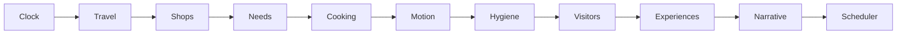

# كشك ع النيل · Kiosk on the Nile

An Arabic Godot port of the included three-quarter HTML prototype. The original
`kiosk_on_the_nile_2d_three_quarter_top_down.html` remains the reference, unchanged.

## Open and run

Pinned stack: **Godot Standard 4.7.2**, Compatibility renderer, GDScript,
**inklecate 1.2.1**, and the vendored Godot 4 `inkgd` adapter. Cairo is bundled
under the SIL Open Font License. Exact upstream revisions and artifact checksums
are in `tools/dependencies.lock.json`; upstream plugin files are unmodified.

From the repository root, on Linux x86_64:

```bash
bash tools/setup.sh
bash tools/godot.sh --editor --path .
# Or launch the game directly:
bash tools/godot.sh --path .
```

Setup requires Python 3, Git, Node/npm and network access to the pinned upstream
artifacts. It downloads the engine, compiler and Web export templates into
`.cache/`, verifies their digests, installs local browser tooling, compiles Ink,
and imports assets. `tools/godot.sh` gives Godot writable XDG directories in this
cloud workspace. Desktop users may instead open `project.godot` with Godot 4.7.2.

New Game starts on the rooftop at 15:30. Use WASD/arrows to move, **E** to interact,
**F** for the nearby secondary action or personal consumption, and **N** for the
notebook. Conversation choices use the mouse and leave the world running.
The title screen has New/Continue. The compact HUD menu contains Save, inventory, arrangement, cleaning, notebook and shopping journeys.

## Change gameplay without rebuilding the engine project

`content/manifest.json` identifies a complete external JSON bundle. It contains
initial session/home state, balance, needs, time/dependency order, location geometry/interactions, recipes,
visitors/schedules, social facts/relationship defaults, dialogue conditions, UI,
input bindings and atmosphere/audio mix. Edit this data and reload the page/restart the application. New/Continue in an already running application keeps that run’s validated bundle. Web JSON requests use a fresh load identifier so browser caching does not hide edits.
There is no mid-transaction hot reload.

For a separate native authoring bundle, copy the entire `content/` directory:

```bash
bash tools/godot.sh --path . -- --content-dir /absolute/path/to/content
```

All required sections and cross-references are validated before the application
accepts a bundle. Invalid data reports a content error rather than starting a
partially configured session. `ContentStore` also supports partial bundles for
isolated tooling; the application explicitly requires the full game profile.

Dialogue text and replies live in `content/stories/*.ink`. Compile edits with:

```bash
bash tools/compile-ink.sh
```

The generated `.ink.json` files are tracked and independently replaceable. Keep
`context.inkinc` alongside the sources. Adding a new behavior still requires
GDScript; adding instances or changing existing parameters uses data.

Initial hidden directional relationships can be authored in
`social.initial_relationships` as `from → to → axis → value` dictionaries; default
content uses the declared relationship defaults. `encounters.context_conditions`
projects canonical predicates into declared Ink variables, including familiarity.

Active cooking jobs retain their original recipe parameters until completion;
the next job uses updated tuning. Existing orders retain their quoted price and
tips. Existing visits retain their food intention/stay duration. Active Ink
sessions require the exact saved story hash. The content fingerprint is diagnostic
rather than a blanket rejection of compatible numeric changes.

## Feature boundaries

| Directory | Owns |
| --- | --- |
| `game/app` | Startup and retained session composition |
| `game/content` | Atomic JSON loading and definition validation |
| `game/time` | Authoritative clock, dependency order and prerequisite-aware jobs |
| `game/items` | Owned instances, containers, ingredient reservations and hand/surface transfers |
| `game/spaces` | Shared grid rules, placements, structural data and player arrangement |
| `game/cooking` | Equipment resources, frozen recipe workflows, real learning evidence and legacy active-job adapter |
| `game/travel`, `game/commerce` | Journey phases/deadlines, shop stock, quotes and confirmed receipts |
| `game/hygiene`, `game/social` | Cleanliness/cleaning and observed visit experiences/reputation |
| `game/service`, `game/economy`, `game/life` | Orders/payments, supplies, needs and home actions |
| `game/actors` | Visitor lifecycle/memory and native physical movement adapters |
| `game/narrative` | Real Ink sessions, facts, directional relationships and finite conditions |
| `game/persistence` | Versioned snapshots, candidate restoration and file replacement |
| `game/world`, `game/presentation`, `game/ui` | Native rooms, reusable visuals, sound and Arabic controls |

The declared default simulation order is:



Every system sees the same clock frame. Missing dependencies and cycles are
rejected before play. Scheduler jobs have explicit clock domains, prerequisites,
deadlines and visible statuses; blocked jobs do not stop time. Rendering, water,
boat, fan and vapour animation do not advance canonical state.

The clock now follows calendar days: midnight advances the day whether awake or
asleep. Rent is assessed once per new calendar day, never per nap, with no arrears.
`world_minutes` and `simulation_seconds` remain monotonic during sleep.

At the bed, choose 1–12 hours and see the expected wake day/time. Duration-based
recovery is configured in `needs.sleep`; `wellbeing.json` controls duration limits,
oversleep and work quality. Default deterministic rules are:

| Condition before sleep/work | Effect |
| --- | --- |
| Mood below 35 and rest below 35 | Sleep 2 additional hours |
| Otherwise mood below 55 and rest below 60 | Sleep 1 additional hour |
| Other sleep conditions | Wake after the requested duration |
| Mood below 35 when preparation starts | Reduce technique quality by up to 2 grades |
| Otherwise mood below 60 when preparation starts | Reduce it by up to 1 grade |
| Mood at least 60 | Preserve the technique result |

Unburnt food has a minimum final grade of 1; actually burnt food stays burnt.
The modifier is captured in the active job and saved, so reloading or changing
mood mid-batch cannot reroll its result. Unattended stations consume the elapsed
sleep time and can overbrew/burn. Sleep ends current visits/orders/conversations;
same-day naps retain daily encounter flags. New calendar days reset those flags.

## Web build

```bash
bash tools/build.sh --out /tmp/kiosk-web
# Release:
bash tools/build.sh --release --out /tmp/kiosk-web-release
python3 tools/web/serve.py /tmp/kiosk-web
```

`tools/build.sh` compiles/checks Ink, imports Godot assets and exports; it runs
no gameplay suites. The GitHub workflow uses the same build-only gate and does
not publish a build. Logs are retained under `.cache/build-logs/`.

The server prints its localhost port. Serve over HTTP(S), not `file://`.
Deploy the complete export **including its sibling `content/` directory**.
The application resolves content relative to the page, including subdirectory
hosting. Replacing the sidecar JSON/compiled Ink does not require exporting the
Godot project again. Asset additions and new behaviors may require a new export.

Debug builds retain the dedicated `?qa=ink`, `?qa=spatial`, `?qa=kiosk` and
`?qa=rooftop` qualification scenes. A normal debug game exposes a read-only
`window.gameStatus` snapshot. Release excludes qualification scene files, ignores these query routes and does not
create the probe. No browser bridge can grant money, move actors or run actions.

## Saves

Logical schema version **4** (revision 4) stores canonical items, placements, bags, journeys, receipts, equipment/workflows, hygiene/cleaning and visit experiences, alongside
mid-cook timers, quoted orders, visitor RNG/memory, relationships/fact provenance,
effect occurrence IDs and displayed pending Ink choices. It includes integrity
checksums and story hashes. Restoration creates a separate validated session;
the application replaces the live session only after success.

Version 1 saves are verified using their original serialized checksum and
upgraded in a disposable candidate. Calendar dates are derived from the saved
monotonic timeline; loading never charges rent. Existing active jobs keep their
legacy zero mood penalty, and pending Ink stories still require their original
hash. The original file is not rewritten until the player explicitly saves.
Version 2 uses a stable numeric JSON representation for integrity checks and
records the last assessed rent day. Corrupt/future saves remain rejected.

Files live under `user://saves/session.json`, with a recoverable `previous.json`.
In this cloud workspace `user://` is under `.cache/data/godot/app_userdata/`.
Use Godot's **Project → Open User Data Folder** on a desktop. Native writes use
a temporary file and rename. Web uses Godot's persistent `user://` filesystem and
requests a supported filesystem sync; browser retention depends on the origin,
profile, available storage and completion of that asynchronous sync. Storage
reported unavailable by Godot produces a failure. HTML localStorage saves are
not imported.

## Development commands and current evidence

```bash
# Existing native suites (explicit developer invocation):
bash tools/run-tests.sh all
# Existing browser qualification harness, requires Chromium:
node tools/web/check.mjs --build /tmp/kiosk-web --scenario ink
```

Generated audio is original procedural PCM, reproducible with
`python3 tools/generate_audio.py`. No external audio or online font service is
needed at runtime.

See [docs/PORT_PARITY.md](docs/PORT_PARITY.md) for implementation mapping and the
remaining acceptance work. The latest integration has not completed full-day,
complete-session browser reload or final visual/audio acceptance; successful
import/export does not establish gameplay parity.


## Equip, arrange and maintain the venues

- **Arrangement:** choose an owned or stored piece from the HUD menu. Click the ground grid, rotate with **R**, confirm with **Enter**, or cancel with **Esc**. Choosing a counter host aligns a mountable appliance to it. Food must be removed before moving its counter; operating/cleaning equipment cannot move. Previewing keeps the committed position intact.
- **Shopping:** use the market, appliance or homeware journey. Going and returning consume the same world clock; cooking/customers continue throughout browsing. Confirm the quoted quantity/price, then return. Furniture goes to the origin venue’s furniture storage; groceries remain in the purchase bag until unpacked. A full container keeps the remainder in the bag.
- **Storage and cooking:** ingredients belong to their actual venue. Cold ingredients require a placed, enabled fridge there; a purchase bag cannot feed cooking. Put carried items on free surfaces and pick up the same instance later. Open a device’s recipe/actions panel for its supported methods. The kettle’s secondary panel also changes sugar.
- **Shawarma:** hear the basics from Farid, obtain the equipment/ingredients, prepare a vessel, physically store it in the fridge, carry it to the spit, slice finite portions, then assemble with bread and sauce on a free surface. Tips do not grant equipment or quality. Potato frying and baking use separate methods on the same ingredient.
- **Cleaning:** furniture/equipment care is contextual; floor cleaning is in the HUD menu. Time continues, leaving interrupts the task, and actual progress survives. Dirt remains when a piece is stored. Food-contact hygiene affects that batch; floors/seats affect observed venue experience. Very dirty beds reduce rest recovery by 10%, shown before sleep.

The same placement service supports home and kiosk. Structural walls, doors and
explicit room cells are authored through the **Living Spaces** Godot editor dock;
player commands reject structural editing. Runtime door use is separate.

| Data | Controls |
| --- | --- |
| `items`, `containers`, `spaces`, `initial_layout` | Definitions, real storage, grid/structure and starting layout |
| `equipment`, `recipe_workflows`, `foods`, `learning` | Shared capabilities/resources, steps/timing, food values and learning families |
| `travel`, `shops` | Routes, catalogue, stock, prices and restock deadlines |
| `hygiene`, `customer_experience` | Dirt/cleaning, observations, scoring, sensitivity and recovery demand floor |

Deleting a referenced ID or changing the meaning of an active step requires an
explicit migration. Active jobs keep their necessary definition/time domain;
old active tea/kebda jobs finish on their saved seconds-based rules. Existing
prices, paid receipts, item identities and matching archived Ink cursors survive
compatible content changes. Schemas 1–3 and private schema-4 revisions upgrade
without charging money or inventing bad past experiences.

### Downloaded Web build on Windows

Extract the **whole ZIP**, keep `content/` beside `index.html`, then in that folder:

```powershell
py -m http.server 8765 --bind 127.0.0.1
```

Open **http://127.0.0.1:8765/**. Each export uses versioned engine filenames;
keep the generated JS/WASM/PCK/worklet files together. After replacing an older
build, refresh the page; Ctrl+Shift+R also clears older cached startup files.
A browser/profile/origin change uses a separate browser save store.

Current implementation and manual evidence/limits are in
[the living-spaces notes](docs/notes/2026-10-22-living-spaces-d.md).
